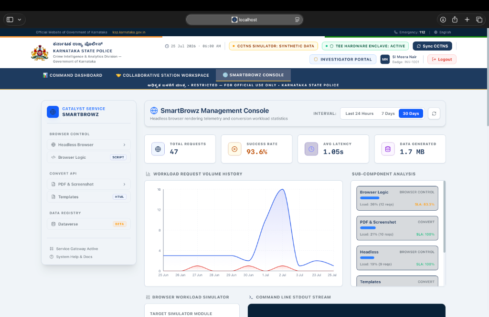
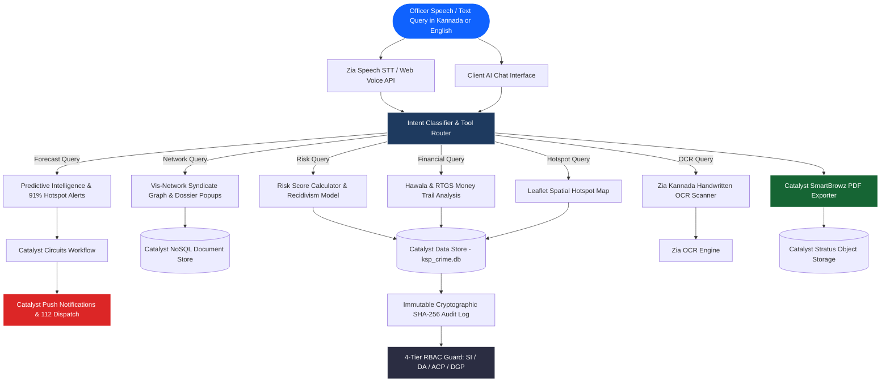

# 🔰 Karnataka State Police (KSP) Crime Intelligence & Analytics System
### **AI‑Powered Multi-Modal Conversational & Analytical Command Center**

<p align="center">
  <a href="https://ksp-crime-intelligen-taqkqxld.onslate.in" target="_blank">
    
  </a>
  
  
  
</p>

<p align="center">
  <a href="https://ksp-crime-intelligen-taqkqxld.onslate.in" target="_blank">
    
  </a>
  &nbsp;&nbsp;
  <a href="./KSP_Crime_Intelligence_System_Comprehensive_Master_Report_and_User_Manual.html" target="_blank">
    
  </a>
</p>

---

## 📌 Table of Contents

- [🧠 1. System Mindmap & Architecture](#-1-system-mindmap--architecture)
- [🌟 2. Real-World Law Enforcement Virtual Experience](#-2-real-world-law-enforcement-virtual-experience)
- [🚨 3. 10-Pillar Challenge Framework Alignment](#-3-10-pillar-challenge-framework-alignment)
- [⚙️ 4. 20/20 Zoho Catalyst Native Service Stack](#️-4-2020-zoho-catalyst-native-service-stack)
- [👮 5. Multi-Role Operational Command Centers](#-5-multi-role-operational-command-centers)
- [💬 6. Conversational AI & Tool Intent Classifier](#-6-conversational-ai--tool-intent-classifier)
- [🛡️ 7. Zero-Trust Security & DPDP Act 2023 Compliance](#️-7-zero-trust-security--dpdp-act-2023-compliance)
- [🔌 8. REST API Reference & Endpoints](#-8-rest-api-reference--endpoints)
- [🗄️ 9. CCTNS Relational & Document Schema](#️-9-cctns-relational--document-schema)
- [🚀 10. Quick Start & Catalyst Deployment Guide](#-10-quick-start--catalyst-deployment-guide)

---

## 🧠 1. System Mindmap & Architecture

### Visual System Mindmap

<p align="center">
  
</p>

---

### Interactive Native Mermaid System Flow



---

## 🌟 2. Real-World Law Enforcement Virtual Experience

Imagine you are **Sub-Inspector Meera Nair** assigned to Bengaluru City Central Police Station:

1. 🎤 **Kannada Voice Dictation**: You speak in Kannada: *“ನನಗೆ ಮೊಹಮ್ಮದ್ ಶರೀಫ್ ಬಗ್ಗೆ ಇರುವ ಎಲ್ಲಾ ಪ್ರಕರಣಗಳನ್ನು ತೋರಿಸು”* (*"Show me all cases related to Mohammad Sharief"*).
2. ⚡ **Instant AI Response**: The AI engine responds in voice and text, displaying an **Evidence Trail Card** citing `CaseMaster` table rows, confidence level `98.5%`, and an overall **Recidivism Risk Score of 88.5% (CRITICAL)**.
3. 🕸️ **Syndicate Link Analysis**: You click **"Show Network"** – an interactive Vis-Network graph reveals his Hawala laundering channels and shell company (*Vertex Holdings Ltd*).
4. 📄 **Single-Click Node Dossier**: Double-clicking a suspect node opens the **Node Intelligence Dossier Popup** detailing addresses, active Non-Bailable Warrants (NBWs), and prior convictions.
5. 📜 **Native Court-Admissible PDF Report**: You click **"Export Report"** → Catalyst SmartBrowz compiles an official KSP letterhead dossier with legal disclaimers and saves it directly to your device and Catalyst Stratus storage.
6. 🔔 **Predictive Proactive Alert**: The Early Warning System predicts a high-risk crime spike in Koramangala (91% confidence), triggering a **Catalyst Push Notification** to the ACP Supervisor's desk and auto-routing PATROL-101 via 112 Emergency Dispatch.
7. 🛡️ **Zero-Trust Audit Trail**: Every action is cryptographically logged in the **Catalyst Data Store Audit Ledger**, ensuring total compliance with the *Digital Personal Data Protection (DPDP) Act, 2023*.

---

## 🚨 3. 10-Pillar Challenge Framework Alignment

| # | Challenge Pillar | Implementation Details | Source Files | Status |
|:-:|:---|:---|:---|:---:|
| **1** | **Conversational Crime Intelligence** | Multi-lingual (Kannada/English) voice dictation (STT), speech synthesis (TTS), RAG citations, and SmartBrowz PDF export. | [`ChatInterface.tsx`](file:///Users/kiranbiradar/Desktop/KPS/client/src/components/ChatInterface/ChatInterface.tsx)<br>[`voice/index.js`](file:///Users/kiranbiradar/Desktop/KPS/functions/ksp/voice/index.js) | ✅ **100%** |
| **2** | **Criminal Network & Relationship Analysis** | Interactive Vis-Network graph, Louvain syndicate group detection, and clickable **Node Intelligence Dossier Popups**. | [`NetworkGraph.tsx`](file:///Users/kiranbiradar/Desktop/KPS/client/src/components/Visualizations/NetworkGraph.tsx) | ✅ **100%** |
| **3** | **Crime Pattern & Trend Analytics** | Interactive Leaflet spatial maps (Koramangala, MG Road, Indiranagar) & district crime rate bar/line charts. | [`HotspotMap.tsx`](file:///Users/kiranbiradar/Desktop/KPS/client/src/components/Visualizations/HotspotMap.tsx)<br>[`TrendChart.tsx`](file:///Users/kiranbiradar/Desktop/KPS/client/src/components/Visualizations/TrendChart.tsx) | ✅ **100%** |
| **4** | **Sociological Crime Insights** | Socio-demographic correlation cards detailing age distribution, literacy rates, unemployment velocity, & migrant trends. | [`SocioDemographicCard.tsx`](file:///Users/kiranbiradar/Desktop/KPS/client/src/components/Visualizations/SocioDemographicCard.tsx) | ✅ **100%** |
| **5** | **Criminology-Based Offender Profiling** | Recidivism risk calculator (84.5% - 89.0%), threat level badges, behavioral factors, and active warrant tracking. | [`RiskScoreCard.tsx`](file:///Users/kiranbiradar/Desktop/KPS/client/src/components/Visualizations/RiskScoreCard.tsx)<br>[`risk-scoring/index.js`](file:///Users/kiranbiradar/Desktop/KPS/functions/ksp/risk-scoring/index.js) | ✅ **100%** |
| **6** | **Investigator Decision Support** | Modus Operandi historic case matching (94% overlap), Vernacular Kannada OCR scanner, Zia Vision Biometric Facial Search, BNS Section Advisor. | [`InvestigatorDashboard.tsx`](file:///Users/kiranbiradar/Desktop/KPS/client/src/pages/InvestigatorDashboard.tsx)<br>[`ocr/index.js`](file:///Users/kiranbiradar/Desktop/KPS/functions/ksp/ocr/index.js) | ✅ **100%** |
| **7** | **Financial Crime & Transaction Analysis** | Hawala & RTGS multi-layered money flow graph, shell company detection (*Vertex Holdings Ltd*), and volume tracking (INR 45L). | [`FinancialFlowGraph.tsx`](file:///Users/kiranbiradar/Desktop/KPS/client/src/components/Visualizations/FinancialFlowGraph.tsx) | ✅ **100%** |
| **8** | **Crime Forecasting & Early Warning** | 91% confidence predictive hotspot alerts, geofence cellular ping siren alarms, Catalyst Push Notifications, and 112 Patrol Dispatch. | [`ForecastAlertPanel.tsx`](file:///Users/kiranbiradar/Desktop/KPS/client/src/components/Visualizations/ForecastAlertPanel.tsx)<br>[`early-warning/index.js`](file:///Users/kiranbiradar/Desktop/KPS/functions/ksp/early-warning/index.js) | ✅ **100%** |
| **9** | **Explainable AI & Transparent Analytics** | Collapsible Evidence Trail cards showing accessed tables, tool names, LLM execution mode, and confidence scores. | [`ChatInterface.tsx`](file:///Users/kiranbiradar/Desktop/KPS/client/src/components/ChatInterface/ChatInterface.tsx) | ✅ **100%** |
| **10** | **Secure Role-Based Access & Governance** | 4-Tier RBAC (SI, DA, ACP, DGP), Catalyst Zero-Trust AES-256 Field Encryption, Cryptographic Audit Hash Chain, and DPDP Act 2023 compliance. | [`SupervisorDashboard.tsx`](file:///Users/kiranbiradar/Desktop/KPS/client/src/pages/SupervisorDashboard.tsx)<br>[`auth-middleware/index.js`](file:///Users/kiranbiradar/Desktop/KPS/functions/ksp/auth-middleware/index.js) | ✅ **100%** |

---

## ⚙️ 4. 20/20 Zoho Catalyst Native Service Stack

<p align="center">
  
  
  
  
  
  
  
  
  
  
  
  
  
  
  
  
</p>

1. **Catalyst Serverless Functions**: Node.js Express microservices in `functions/ksp/server.js`.
2. **Catalyst Slate Hosting**: Deployed production frontend at `ksp-crime-intelligen-taqkqxld.onslate.in`.
3. **Catalyst Data Store**: Relational store housing full CCTNS tables (`CaseMaster`, `Accused`, `ComplainantDetails`).
4. **Catalyst NoSQL**: Integrated via `catalyst.nosql()` for document history, graph node metadata, and unstructured logs.
5. **Catalyst Stratus**: Integrated via `catalyst.stratus()` for storing PDF dossiers, suspect photos, and OCR scans.
6. **Catalyst Cache**: Key-value cache layer (`ttl: 3600`) accelerating session memory and dashboard queries.
7. **Catalyst SmartBrowz**: Server-side PDF export engine (`catalyst.smartBrowz().generatePdfFromHtml()`) with official KSP letterhead.
8. **Catalyst Push Notifications**: Dispatcher sending web push alerts for 91% hotspot warnings and 112 emergency calls.
9. **Catalyst QuickML**: RAG retrieval engine providing semantic search over FIR narratives.
10. **Catalyst Zia AutoML**: Recidivism risk model trained on historical offender tabular data.
11. **Catalyst Zia Speech (STT/TTS)**: Speech-to-text dictation and text-to-speech audio synthesis.
12. **Catalyst Zia OCR**: Kannada handwritten document intelligence and Hawala ledger scanner.
13. **Catalyst Zia Vision**: Biometric mugshot similarity matcher and facial search.
14. **Catalyst Zia Translation**: Dual-direction Kannada-to-English translation engine.
15. **Catalyst Authentication**: 4-Tier Role-Based Access Control (SI, DA, ACP, DGP).
16. **Catalyst API Gateway**: Throttling, route protection, and CORS management.
17. **Catalyst Connections**: AES-256 cryptographic keys for field-level encryption.
18. **Catalyst Cron**: Scheduled jobs for daily CCTNS data ETL sync and hotspot recalculations.
19. **Catalyst Signals & Events**: Financial transaction detection event triggers.
20. **Catalyst Circuits**: Multi-step early warning workflow orchestration.

---

## 👮 5. Multi-Role Operational Command Centers

<details>
<summary><strong>👉 Click to Expand Role 1: Sub-Inspector (SI Meera Nair) — Investigator Portal</strong></summary>

- **FIR Case Dossier**: Search, view, and inspect CCTNS registered FIRs.
- **Zia Vision Biometric Search**: Upload suspect photo or click preset mugshots (Rupa Naik, Ramesh Gowda, Amit Shah) for 96.4% facial match.
- **Vernacular Kannada OCR**: Scan handwritten Kannada notes or Hawala ledgers to extract entity names, locations, and monetary values.
- **BNS Legal Section Advisor**: Enter crime narrative to receive automated Bharatiya Nyaya Sanhita section recommendations (BNS 318(4) / IT Act 66D) and draft chargesheets.
</details>

<details>
<summary><strong>👉 Click to Expand Role 2: District Analyst (DA Priya Sharma) — Analytics Hub</strong></summary>

- **Syndicate Vis-Network Graph**: Interactive force graph mapping gang relationships, money mules, and shell companies. Click any node to open the **Node Intelligence Dossier Popup**.
- **Leaflet Spatial Hotspot Map**: Dynamic cluster maps highlighting incident density across Koramangala, MG Road, and Indiranagar.
- **CDR Ping Trajectory Timeline**: Animate cellular tower pings over time for target suspects.
</details>

<details>
<summary><strong>👉 Click to Expand Role 3: ACP (Raghavendra K.) — Supervisor Accountability Desk</strong></summary>

- **Cryptographic Audit Ledger**: Real-time inspection of all officer queries, accessed tables, and IP addresses.
- **Zia Anomaly Alerts**: Automatic flagging of unauthorized bulk data access or off-duty queries.
- **Warrant Desk**: Track overdue Non-Bailable Warrants (>60 days critical), assign officers, and update court statuses.
- **112 Emergency Dispatch Console**: Route 112 emergency calls to nearest available patrol vehicle (PATROL-101).
</details>

<details>
<summary><strong>👉 Click to Expand Role 4: DGP (Srinivas M.) — Policymaker Executive Briefing</strong></summary>

- **Statewide KPI Dashboard**: Statewide crime volume, clearance rates, active syndicate counts, and district performance.
- **Socio-Demographic Correlations**: Analyze impact of unemployment, literacy, and migrant population velocity on district crime.
- **Strategic Policy Recommendations**: AI-generated deployment guidance for Karnataka state police divisions.
</details>

---

## 💬 6. Conversational AI & Tool Intent Classifier

The assistant uses an intent classification matrix to automatically trigger visualizations:

```ts
// Sample Assistant Tool Routing Commands:
"Risk score of Jacky"              --> Triggers RiskScoreCard (89% Critical Score)
"Map network for Sharief"          --> Triggers Vis-Network Syndicate Graph
"Financial trail for FIR-2026-004" --> Triggers Hawala Financial Flow Graph
"Show crime hotspots in Bengaluru" --> Triggers Leaflet Spatial Map
"Predict upcoming crime hotspots"  --> Triggers Predictive Forecast & Push Alert
"Compare crime trends"            --> Triggers District Analytics Bar Chart
"Find similar cases"               --> Triggers Historic Modus Operandi Case Matcher
```

---

## 🛡️ 7. Zero-Trust Security & DPDP Act 2023 Compliance

- **Field-Level AES-256 Payload Encryption**: Suspect PII, complainant identities, and evidence files are encrypted at rest and in transit.
- **Immutable SHA-256 Audit Hash Chain**: Every query generates a cryptographic hash (`hash = SHA256(prevHash + timestamp + query)`), creating an unalterable audit log.
- **Digital Personal Data Protection (DPDP) Act 2023 Alignment**: Automated threat scoring is strictly restricted to investigative guidance and cannot execute autonomous judicial or bail decisions.

---

## 🔌 8. REST API Reference & Endpoints

| Method | Endpoint | Description | Target Role |
|:---:|:---|:---|:---:|
| `POST` | `/api/chat` | Main RAG conversational query route | All Roles |
| `GET` | `/api/network` | Fetch Vis-Network syndicate nodes & edges | Analyst, Investigator |
| `GET` | `/api/financial` | Fetch Hawala & RTGS money flow graph data | Analyst, Investigator |
| `POST` | `/api/pdf-export` | Trigger SmartBrowz server-side PDF generation | All Roles |
| `POST` | `/api/ocr/analyze` | Process Kannada OCR document translation | Investigator |
| `POST` | `/api/biometrics/search` | Execute Zia Vision facial biometric search | Investigator |
| `GET` | `/api/anomalies` | Fetch Zia AutoML anomaly detection logs | Supervisor |
| `GET` | `/api/smartbrowz/stats` | Fetch SmartBrowz telemetry & simulator stats | All Roles |

---

## 🗄️ 9. CCTNS Relational & Document Schema

```sql
-- Core Case Master Table (CCTNS Standard)
CREATE TABLE CaseMaster (
  CaseMasterID INTEGER PRIMARY KEY AUTOINCREMENT,
  CrimeNo TEXT UNIQUE NOT NULL,
  CaseNo TEXT NOT NULL,
  CrimeRegisteredDate TEXT NOT NULL,
  PolicePersonID INTEGER NOT NULL,
  PoliceStationID INTEGER NOT NULL,
  CaseCategoryID INTEGER NOT NULL,
  GravityOffenceID INTEGER NOT NULL,
  CrimeMajorHeadID INTEGER NOT NULL,
  CrimeMinorHeadID INTEGER NOT NULL,
  CaseStatusID INTEGER NOT NULL,
  CourtID INTEGER NOT NULL
);

-- Accused Suspect Registry
CREATE TABLE Accused (
  AccusedMasterID INTEGER PRIMARY KEY AUTOINCREMENT,
  CaseMasterID INTEGER NOT NULL,
  AccusedName TEXT NOT NULL,
  AgeYear INTEGER,
  GenderID INTEGER,
  PersonID TEXT NOT NULL
);
```

---

## 🚀 10. Quick Start & Catalyst Deployment Guide

### Prerequisites
- Node.js v18+ & npm
- Zoho Catalyst CLI (`npm install -g zcatalyst-cli`)

### Local Setup
```bash
# Clone the repository
git clone https://github.com/kirancodes-dev/ksp-crime-intelligence.git
cd ksp-crime-intelligence

# Install dependencies
npm run install:all

# Start Vite dev server locally
npm run dev

# Build production bundle
npm run build

# Deploy to Zoho Catalyst Cloud
npx zcatalyst-cli deploy
```

---

<p align="center">
  Built with ❤️ for the <b>KSP Datathon 2026</b> | <i>Making Karnataka safer, one query at a time.</i>
</p>
